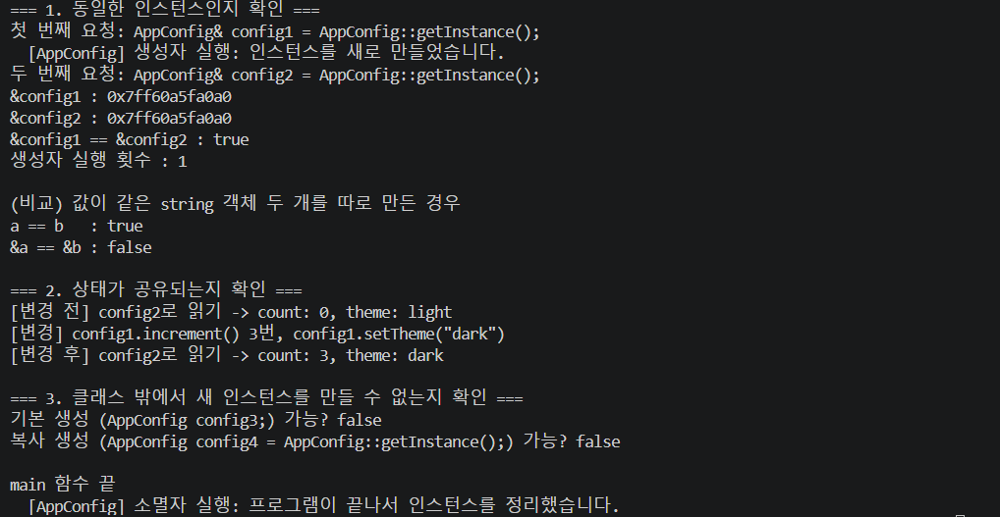

# Singleton 패턴 구현 (C++)

초급프로젝트 11주차 실습 과제입니다. C++로 Singleton 패턴을 구현하고, 두 변수가 하나의 인스턴스를 공유하는지 실행 결과로 확인했습니다.

## 1. 언어와 실행 환경

| 항목 | 버전 |
| --- | --- |
| 언어 | C++17 |
| 컴파일러 | g++ 15.2.0 (MinGW-w64, x86_64-ucrt-posix-seh) |
| 운영체제 | Windows 11 |

- 표준 라이브러리만 사용해서 따로 설치할 라이브러리는 없습니다.
- Visual Studio 2022의 MSVC 19.44 컴파일러로도 빌드해서, 주소 값을 빼고 같은 결과가 나오는 것을 확인했습니다.

## 2. 파일 구성

```text
singleton-pattern-cpp/
├── src/
│   ├── AppConfig.h     # Singleton 클래스 선언
│   ├── AppConfig.cpp   # Singleton 클래스 구현
│   └── main.cpp        # 확인용 실행 코드
├── images/
│   └── run-result.png  # 실행 결과 화면
├── .gitignore          # 실행 파일, 오브젝트 파일 제외
└── README.md          # 본인 작성 부분 존재 (6장)
```

컴파일하면 생기는 실행 파일(`singleton.exe`, `singleton`)과 오브젝트 파일(`.o`, `.obj`)은 `.gitignore`로 저장소에서 제외했습니다.

## 3. 실행 방법

C++17을 지원하는 C++ 컴파일러가 있어야 합니다. 저장소 폴더에서 아래 명령을 차례로 실행합니다.

```bash
g++ -std=c++17 -Wall -Wextra -o singleton src/main.cpp src/AppConfig.cpp
./singleton
```

Visual Studio 2022(MSVC)로 빌드할 때는 "Developer PowerShell for VS 2022"에서 아래 명령을 실행합니다. 소스 파일이 UTF-8이라서 `/utf-8` 옵션이 필요합니다.

```powershell
cl /std:c++17 /utf-8 /EHsc /W4 src\main.cpp src\AppConfig.cpp /Fe:singleton.exe
.\singleton.exe
```

> Windows 콘솔은 기본 코드 페이지가 CP949라서 UTF-8로 출력한 한글이 깨집니다. 그래서 `main.cpp` 시작 부분에서 `SetConsoleOutputCP(CP_UTF8)`로 콘솔 출력 코드 페이지를 UTF-8로 바꿉니다. 이 코드는 `#ifdef _WIN32` 안에 있어서 Windows에서만 컴파일됩니다.

## 4. 구현 내용

`src/AppConfig.h`, `src/AppConfig.cpp`의 `AppConfig`(앱 설정 객체)를 C++에서 많이 쓰는 "함수 안 static 지역 변수" 방식(Meyers' Singleton)으로 구현했습니다.

| 요구사항 | 구현 |
| --- | --- |
| 인스턴스 보관 | `getInstance()` 함수 안의 static 지역 변수 `static AppConfig instance;`에 유일한 인스턴스를 저장 |
| 같은 객체 반환 | static 지역 변수는 처음 선언을 지날 때 한 번만 만들어지므로, `getInstance()`는 항상 같은 객체의 참조(`AppConfig&`)를 반환 |
| 생성자 제한 | 생성자를 `private`으로 두어, 클래스 밖에서 `AppConfig config;`나 `new AppConfig()`를 쓰면 컴파일 오류 |
| 복사 제한 | 복사 생성자와 복사 대입 연산자를 `= delete`로 지워서, `AppConfig copy = AppConfig::getInstance();` 같은 복사도 컴파일 오류 |
| 공유 상태 | 카운터 `count`(`increment()`, `getCount()`)와 설정 값 `theme`(`setTheme()`, `getTheme()`) |

```cpp
AppConfig& AppConfig::getInstance() {
    static AppConfig instance; // 처음 호출될 때 한 번만 생성
    return instance;           // 그 뒤로는 보관한 같은 객체를 반환
}
```

C++에서는 `AppConfig& config1 = ...`에서 `&`를 빠뜨리면 참조가 아니라 복사본이 만들어질 수 있습니다. 복사 생성자를 `delete`한 것은 이런 실수로 두 번째 객체가 생기는 것을 막기 위해서입니다.

`src/main.cpp`는 인스턴스를 두 번 얻어 참조 변수 `config1`, `config2`에 저장한 뒤 다음 세 가지를 확인합니다.

1. `&config1 == &config2`로 두 변수가 가리키는 객체의 주소를 비교
2. `config1`로 카운터와 테마를 바꾼 뒤 `config2`로 읽어서 상태가 공유되는지 확인
3. `<type_traits>`의 `std::is_default_constructible_v`, `std::is_copy_constructible_v`로 클래스 밖에서 기본 생성과 복사 생성을 할 수 있는지 컴파일할 때 검사한 결과를 출력

## 5. 실행 결과

`g++`로 컴파일한 뒤 `./singleton`을 실행한 결과입니다. (2026-11-17, Windows 11, g++ 15.2.0)



화면의 출력을 텍스트로 옮기면 다음과 같습니다.

```text
=== 1. 동일한 인스턴스인지 확인 ===
첫 번째 요청: AppConfig& config1 = AppConfig::getInstance();
  [AppConfig] 생성자 실행: 인스턴스를 새로 만들었습니다.
두 번째 요청: AppConfig& config2 = AppConfig::getInstance();
&config1 : 0x7ff60a5fa0a0
&config2 : 0x7ff60a5fa0a0
&config1 == &config2 : true
생성자 실행 횟수 : 1

(비교) 값이 같은 string 객체 두 개를 따로 만든 경우
a == b   : true
&a == &b : false

=== 2. 상태가 공유되는지 확인 ===
[변경 전] config2로 읽기 -> count: 0, theme: light
[변경] config1.increment() 3번, config1.setTheme("dark")
[변경 후] config2로 읽기 -> count: 3, theme: dark

=== 3. 클래스 밖에서 새 인스턴스를 만들 수 없는지 확인 ===
기본 생성 (AppConfig config3;) 가능? false
복사 생성 (AppConfig config4 = AppConfig::getInstance();) 가능? false

main 함수 끝
  [AppConfig] 소멸자 실행: 프로그램이 끝나서 인스턴스를 정리했습니다.
```

- **동일 인스턴스**: `config1`과 `config2`가 가리키는 객체의 주소가 같고, `&config1 == &config2`가 `true`입니다. 생성자 로그는 첫 번째 요청 때 한 번만 나오고, 생성자 실행 횟수도 1입니다.
- **비교용 결과**: 값이 같은 string `a`, `b`는 값 비교(`a == b`)가 `true`여도 주소 비교(`&a == &b`)는 `false`입니다. 값이 같다고 같은 객체는 아니므로, 같은 객체인지는 주소로 비교해야 합니다.
- **상태 공유**: `config1`로 카운터를 3번 올리고 테마를 `dark`로 바꾼 뒤 `config2`로 읽으면 `count: 3`, `theme: dark`가 나옵니다.
- **생성 제한**: 클래스 밖에서 기본 생성과 복사 생성을 할 수 있는지 검사한 결과가 모두 `false`입니다.
- **소멸 시점**: 소멸자 로그는 `main 함수 끝` 다음에 한 번만 나옵니다. static 지역 변수라서 함수가 끝나도 남아 있다가 프로그램이 끝날 때 정리됩니다.

주소 값은 실행 환경에 따라 다르게 나올 수 있고, MSVC로 빌드하면 `0x` 없이 대문자 16진수로 출력됩니다. 중요한 것은 두 주소가 같다는 점입니다.

### 컴파일 단계의 생성 제한

`src/main.cpp`에서 아래 두 줄의 주석을 풀고 다시 컴파일하면, 다음과 같이 컴파일 오류가 나고 실행 파일이 만들어지지 않습니다. (확인한 뒤에는 다시 주석 처리합니다.)

```cpp
AppConfig config3;                             // 생성자가 private
AppConfig config4 = AppConfig::getInstance();  // 복사 생성자가 delete됨
```

```text
src/main.cpp: In function 'int main()':
src/main.cpp:51:15: error: 'AppConfig::AppConfig()' is private within this context
   51 |     AppConfig config3;
      |               ^~~~~~~
In file included from src/main.cpp:3:
src/AppConfig.h:28:5: note: declared private here
   28 |     AppConfig();
      |     ^~~~~~~~~
src/main.cpp:52:48: error: use of deleted function 'AppConfig::AppConfig(const AppConfig&)'
   52 |     AppConfig config4 = AppConfig::getInstance();
      |                                                ^
src/AppConfig.h:11:5: note: declared here
   11 |     AppConfig(const AppConfig&) = delete;
      |     ^~~~~~~~~
src/main.cpp:52:48: note: use '-fdiagnostics-all-candidates' to display considered candidates
   52 |     AppConfig config4 = AppConfig::getInstance();
      |                                                ^
```

## 6. 설명 (본인 작성 부분)

저는 인스턴스를 `getInstance()` 함수 안의 지역 변수(static) `instance`에 보관했습니다. 

static 지역 변수는 일반 지역 변수와 달리 stack 영역이 아니라 data 영역에 있어서 함수가 끝나도 사라지지 않고, 처음 그 줄을 지날 때 한 번만 초기화됩니다. 

따라서 `getInstance()`를 다시 불러도 초기화를 하지않고 건너뛰고, 이미 만들어 둔 객체를 그대로 되돌려주기 때문에 새 객체가 생기지 않습니다. 

실제로 실행해 보니 `config1`과 `config2`의 주소가 똑같이 나왔으며 생성자 로그도 한 번만 찍혔습니다. 

또 `config1`로 count를 3까지 올리고 테마를 dark로 바꾼 뒤 `config2`로 읽어도 같은 값이 나와서, 두 변수가 하나의 인스턴스를 공유한다는 것을 직접 확인할 수 있었습니다.
